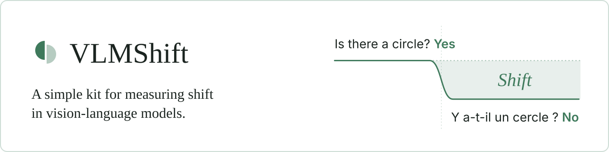
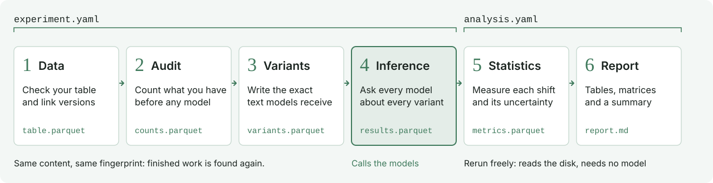

<p align="center">
  
</p>

<p align="center">
  <a href="docs/tutorial.md">Tutorial</a> &nbsp;·&nbsp;
  <a href="docs/documentation.md">Documentation</a> &nbsp;·&nbsp;
  <a href="docs/server.md">NVIDIA server guide</a>
</p>

Show a model the same image with the same question, in English and then in Hindi. Does it answer the same way? Is it wrong more often? Does it depend on where the image comes from?

VLMShift answers with numbers, an uncertainty for each number, and a clear list of what could not be measured.

## How it works

<p align="center">
  
</p>

You describe your experiment in two YAML files, and one command runs the six steps.

| Step | What happens |
|---|---|
| **1. Data** | Your table is checked, and the versions of each image are linked |
| **2. Audit** | The tool counts what you have, before any model runs |
| **3. Variants** | The exact text sent to each model is written and stored |
| **4. Inference** | Every model answers every variant. A crash loses nothing |
| **5. Statistics** | Each shift is measured, with its uncertainty |
| **6. Report** | Tables, matrices and a readable summary |

## Try it

The demo runs a real model, CLIP, on 100 photos of [POPE](https://github.com/RUCAIBox/POPE), a published benchmark whose results are known. It needs no GPU: a few minutes on a normal processor, after a one-time download of CLIP (600 MB) and of the photos (18 MB). You need Python 3.10 or later.

```bash
git clone https://github.com/Algerian-Student-Research-Network/vlmshift-kit.git VLMShift
```

```bash
cd VLMShift
```

```bash
pip install -e ".[local]"
```

```bash
python examples/pope_mini/fetch.py
```

```bash
vlmshift all examples/pope_mini/experiment.yaml examples/pope_mini/analysis.yaml
```

POPE asks "Is there a bird in the image?" about objects that are in the photo, and about objects that are not. The absent object is picked at random, among the most common objects, or among those often seen with the ones in the photo (adversarial). The last line of the output gives the report. It finds what the paper found for its models: the harder the absent object, the more the model says yes when it should say no.

| Absent object | Accuracy of CLIP |
|---|---|
| random | 77.3 |
| popular | 74.3 |
| adversarial | 67.5 |

To put these numbers next to those of the paper, give `compare.py` the path printed on the last line:

```bash
python examples/pope_mini/compare.py <path of report.md>
```

CLIP loses 9.8 points from random to adversarial (likely 6.5 to 13.0). The five models of the paper lose from 0 to 14.4. To check the published numbers themselves, `examples/pope_mini/paper.yaml` runs InstructBLIP-13B, a model of the paper, on an NVIDIA card.

**No NVIDIA card?** Open `examples/pope_mini/colab.ipynb` in Google Colab or Kaggle, which lend one for free: it runs both demos in your browser. See the [Colab and Kaggle guide](docs/colab.md).

## Use your own images

Point VLMShift at a folder of images and give the question once per condition:

```bash
vlmshift init images --question "EN=Is there a dog in this image? Answer yes or no." --question "FR=Y a-t-il un chien dans cette image ? Répondez par oui ou non."
```

It writes a table and two YAML files to adapt. Subfolders named `positive` and `negative` give the labels. Then check everything with no model:

```bash
vlmshift prepare experiment.yaml
```

The [tutorial](docs/tutorial.md) goes through this step by step.

## What makes it useful

- **Any condition.** Any column of your table can be compared: language, site, device, image quality.
- **Fair comparisons.** A translated question is compared to its original on the same image, face to face.
- **Honest uncertainty.** Intervals come from drawing independent units, corrected for multiple comparisons.
- **Nothing invented.** A number with too little data shows as "not estimable", never as 0.
- **Nothing hidden.** The exact text sent to each model is stored, and every problem is reported.
- **Safe to stop.** Answers are cached one by one. Run the command again and the tool resumes.
- **Reanalysis is free.** Statistics read the disk and never call a model.

## Models

| Kind | How to use it |
|---|---|
| Generative models that Hugging Face transformers runs by itself, such as InstructBLIP or LLaVA | One line: `{name: llava, adapter: huggingface, id: <Hugging Face name>}`. Nothing more to install on Colab |
| Any model of the [VLMEvalKit](https://github.com/open-compass/VLMEvalKit) catalogue | One line: `{name: qwen, adapter: vlmevalkit, id: Qwen2.5-VL-7B-Instruct}` |
| Contrastive models, such as CLIP | One line: `{name: clip, adapter: contrastive, id: <Hugging Face name>}` |
| Your own model | A small Python class, see the [documentation](docs/documentation.md#add-a-model) |

Many local models of VLMEvalKit require an NVIDIA card: follow the [NVIDIA server guide](docs/server.md). `vlmshift check` tries each model on a few real questions before a long run.

## Documentation

| Read this | To |
|---|---|
| [Tutorial](docs/tutorial.md) | Run your first experiment, step by step |
| [NVIDIA server guide](docs/server.md) | Run real models on a server, step by step |
| [Colab and Kaggle guide](docs/colab.md) | Run real models with no card of your own |
| [Documentation](docs/documentation.md) | Find any feature, option or output |
| [Project site](docs/index.html) | Choose between the tutorial, the file guide and the documentation |
| [Design](docs/design.md) | Read the full specification and formulas |

To view the site, open `docs/index.html` in a browser. On GitHub, `.github/workflows/pages.yml` publishes it with GitHub Pages at each push to `main`.

## Project layout

| Folder | Content |
|---|---|
| `src/vlmshift/` | Core: one folder per step |
| `packages/med/` | A medical image benchmark built on Core |
| `examples/pope_mini/` | The demo: 100 photos of POPE, and the results of its paper |
| `tests/` | One test file per Core folder, and a tiny dataset for fake models |
| `environments/` | Library lists for each model family |
| `tools/` | Generators of the project site, its images and the Colab notebook |
| `.github/workflows/` | Publishes the site at each push |
| `docs/` | Documentation and site |

## Status

This is a first version.

- **Tested with a real model**: CLIP, from start to finish on a normal processor, on the 100 photos of the demo. Its scores match the standard computation of the model.
- **Tested on a processor only**: SmolVLM-256M through the real VLMEvalKit, on a fresh Linux machine, after changing one line of VLMEvalKit to use the processor. It answered in English and repeated the question in French.
- **Hugging Face adapter**: tested with tiny random LLaVA and InstructBLIP models, and SmolVLM-256M answered real POPE questions on a processor.
- **Google Colab**: the notebook ran from the first cell to the last with the library versions of Colab, on a processor. Not yet on a Colab card.
- **Tested with stand-ins only**: the small LLM (tiny random models).
- **Not done yet**: a run on an NVIDIA card. Do this before trusting a result from a generative model.
- **Med package**: only an example data source is written so far.

## Development

```bash
pytest
```

After changing the code, rebuild the site. A test fails if it is out of date.

```bash
python tools/site/build.py
```

<br>

<p align="center">
  <br>
  <sub>VLMShift is a research tool.</sub>
</p>
